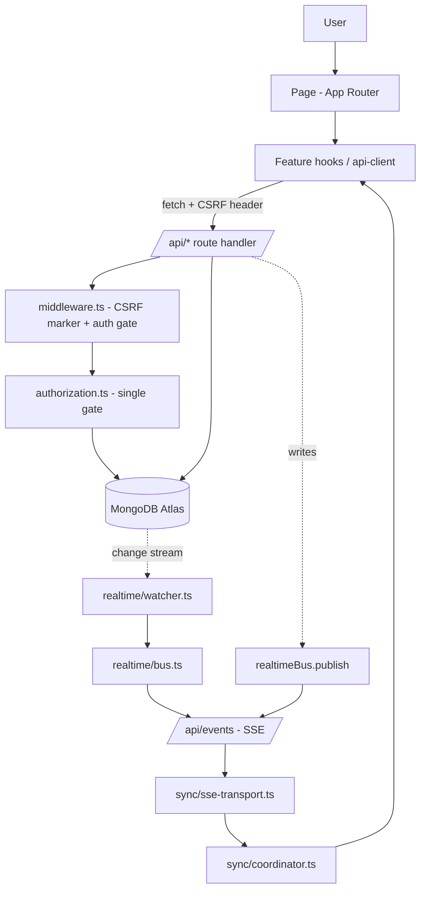

# Decoricks Management App — Complete Codebase Audit, Development Status & Remaining-Work Report

**Audit date:** 2026-10-22
**Branch inspected:** `usability-phase-2` @ `a99b29d` (working tree, including uncommitted changes)
**Method:** read-only static inspection of the repository plus execution of the project's own non-destructive checks (`tsc --noEmit`, `next lint`, `vitest run`, `next build`). No files were modified, no commits made, no database contacted, no seed/migration run. Secrets are referenced by variable name only; no values are printed.

---

## Section 1 — Executive summary

**What exists.** A complete, serious, production-shaped business management application for a four-person furniture business (Decoricks). It is a **Next.js 15 / React 19 / TypeScript** App-Router web app backed by **MongoDB (Atlas)** with a **custom cookie-session auth stack**, a **unified append-only money ledger**, a weighted-average inventory ledger, sales/orders/returns, budgets, P&L, cash flow, profit distribution, tasks, collaborative chat, notifications, an offline queue, and a **Server-Sent-Events realtime layer over MongoDB change streams**.

**Development stage.** Late-stage build. This is not a prototype or a scaffold. Every core module has a real backend, real validation, real permission gating, and — unusually — real tests. The financial engines are particularly strong: integer-paisa money, reversal-only corrections, and a reconciliation panel that independently recomputes every headline figure and fails on any non-zero difference. There are **zero TODO/FIXME/stub markers in production code**; a search for incomplete work found only HTML `placeholder=` attributes and test mocks.

**Strongest areas.** (1) The finance/inventory/sales business logic — correct, tested, and internally consistent. (2) The auth/authorization core — one server-side gate, CSRF enforced inside session resolution, fail-closed permission checks, append-only audit log, and `/api/users`, `/api/roles`, `/api/audit-log`, `/reconciliation` all correctly Founder-only. (3) Breadth of automated tests — 51 unit files / 798 tests passing, 17 e2e spec files across 3 device projects.

**Most important weaknesses.** (1) **The entire tested work is uncommitted** — 161 modified + 46 untracked files; a deploy today would ship a stale commit. (2) **No `netlify.toml` exists**, so the documented deployment target is unconfigured, and the **realtime SSE carrier does not work on serverless** — production would silently fall back to a 6-second polling path that has a real deletion-propagation bug. (3) A handful of **medium-severity correctness/robustness defects**: an unauthenticated login-lockout DoS, a non-transactional ledger reversal that can double-count money, and month-prefix numbering that uses the wrong month for ~21% of each day.

**Readiness verdict: suitable for internal evaluation / controlled staging only — NOT ready for production, and not ready for real business data.** The blockers are deployment configuration and a short list of verified defects, not missing features.

**Top five actions next:**
1. Commit the working tree (after review) — nothing tested is in Git.
2. Create `netlify.toml` with a pinned Node runtime and `TZ=Asia/Karachi`, and decide the realtime deployment story (persistent host for SSE vs. accepting polling).
3. Fix the six P0/P1 defects listed in Section 7 (lockout DoS, ledger-reversal transaction, month-prefix month, polling delete-propagation, board idempotency, `/design` 404).
4. Rotate the exposed Atlas credential in Git history and remove the hardcoded E2E password fallbacks.
5. Add this README + CI, then run the full `npm run verify` and e2e suite in CI.

---

## Section 2 — Technology and architecture map

### 2.1 Technology stack (from installed packages / config)

| Concern | Technology | Version | Purpose here |
|---|---|---|---|
| Framework | Next.js (App Router) | `^15.1.4` | Routing, server components, API routes, SSR |
| UI library | React / ReactDOM | `^19.0.0` | Client rendering |
| Language | TypeScript | `^5.7.2` | Whole codebase |
| Styling | Tailwind CSS + PostCSS + Autoprefixer | `3.4.17` | Utility CSS, responsive |
| Animation | GSAP | `^3.15.0` | Page transitions, micro-interactions |
| Icons | react-icons | `^5.7.0` | Icon set |
| Charts | Recharts | `^2.15.4` | Dashboard/trend/budget charts |
| Drag & drop | @dnd-kit/core | `^6.3.1` | Task board |
| Database | MongoDB driver | `^6.21.0` | Atlas connection; source of truth |
| Auth | **Custom** (no NextAuth) | — | bcrypt + server sessions + CSRF |
| Hashing | bcryptjs | `^2.4.3` | Password hashing (cost 12) |
| Validation | zod | `^3.24.1` | All API input + env |
| Offline store | Dexie + dexie-react-hooks | `^4.4.6` / `^4.4.0` | IndexedDB queue |
| Push | web-push | `^3.6.7` | Web Push (VAPID) |
| PDF | pdf-lib | `^1.17.1` | Report PDF export |
| Unit tests | Vitest | `^2.1.8` | 798 tests |
| E2E tests | Playwright | `^1.49.1` | 3 device projects |
| DB-in-tests | mongodb-memory-server | `^10.4.3` | 3 suites use a real Mongo |
| Build/dev tooling | tsx, eslint 9, prettier | — | Scripts, lint, format |
| Hosting (documented) | Netlify (serverless) | — | **No config file exists** |

**State management:** no Redux/Zustand — React context (`AuthProvider`, `OfflineProvider`, `ShellLayoutProvider`) plus per-feature hooks.
**Data fetching:** hand-rolled `fetch` wrappers (`src/lib/api-client.ts`) with CSRF header injection; React hooks for polling/realtime; no TanStack Query.

### 2.2 Architecture and data flow (confirmed)



The core request path: **UI → `apiFetch` (adds CSRF header) → route handler → `getAuthenticatedUser` (session + CSRF) → `authorize(module, action)` → MongoDB → JSON envelope → UI update**. Every mutation is an `/api/` route (there are **no `"use server"` files**), so the middleware CSRF stamp covers the whole mutating surface.

**Realtime path:** one change stream per process → dataless signals (`{module, ts}`) → in-process bus → SSE frames → client coordinator → module refetch. A polling fallback (6 s) exists for when SSE can't hold.

### 2.3 Directory architecture

| Directory | Contents |
|---|---|
| `src/app/(app)/` | Authenticated pages (dashboard, finance, inventory, sales, tasks, chat, settings, …) |
| `src/app/(auth)/` | Login and change-password pages |
| `src/app/api/` | 86 route handlers (the entire mutating surface) |
| `src/components/` | Layout shell, UI primitives, dashboard, chat, notifications, offline, settings, tasks |
| `src/hooks/` | `useAppNavigation`, `useNotifications`, `useOfflineQueue`, `useOptimisticMutation`, `usePolling` |
| `src/lib/` | 154 files — all business logic, services, models, schemas, sync, offline, notifications, metrics |
| `src/lib/models/` | 12 model files defining **31 MongoDB collections** |
| `src/modules/` | Feature-scoped UI (finance, budget, inventory, sales) |
| `src/e2e/` | 17 Playwright specs + setup |
| `scripts/` | Seed, migration, and 12 audit/measurement instruments |
| `docs/` | SPEC, METRICS, REALTIME, OFFLINE_AND_NOTIFICATIONS, PHASE5-QA-REPORT |
| `public/` | PWA manifest, service worker, offline page, icons |

---

## Section 3 — Complete module inventory

**31 routable pages exist** (30 in `src/app/(app)` + `(auth)` + probes). Nav is permission-filtered (`src/components/layout/nav-config.tsx`). Summary table:

| Module | Route | Backend | Status | Notes |
|---|---|---|---|---|
| Dashboard | `/` | `/api/dashboard`, `/summary` | Implemented, verified | Single parallel snapshot; 531 ms warm |
| Finance (ledger) | `/finance`, `/finance/transactions`, `/accounts`, `/categories` | `/api/finance/*` | Implemented, verified | Unified ledger, reversals, idempotency |
| Budgets | `/budgets`, `/budgets/[id]` | `/api/budgets/*` | Implemented, verified | Actuals recomputed, never stored |
| Profit & Loss | `/profit-loss` | `/api/finance/pl` | Implemented, verified | SPEC §5 formulas reproduced in tests |
| Cash Flow | `/cash-flow` | `/api/finance/cash-flow` | Implemented, verified | Correctly separated from profit |
| Profit Distribution | `/distributions`, `/[id]` | `/api/finance/distributions/*` | Implemented, **partial** | Approve/distribute posts no ledger entries (E1) |
| Reconciliation | `/reconciliation` | `/api/dashboard/reconciliation` | Implemented, verified | Founder-only; independent recompute |
| Inventory | `/inventory`, `/products`, `/movements`, `/purchases` | `/api/stock/*`, `/api/products/*`, `/api/purchases/*` | Implemented, verified | WAC, atomic negative-stock guard |
| Sales | `/sales`, `/[id]`, `/returns` | `/api/orders/*`, `/api/returns/*` | Implemented, verified | Server-authoritative pricing, COD lifecycle |
| Tasks | `/tasks` | `/api/boards/*`, `/api/tasks/*` | Implemented, verified | Board idempotency broken (P1) |
| Chat | `/chat` | `/api/chat/*` | Implemented, verified | Mentions, references, unread, rate-limited |
| Suppliers | `/suppliers` | `/api/suppliers/*` | Implemented, **untested** | No sync signal for the collection |
| Weekly Summary | `/weekly-summary` | `/api/reports/period` | Implemented, partial | No live subscription |
| Reports/Exports | (no dedicated page) | `/api/reports/*` | Implemented, verified | CSV + PDF, single aggregation source |
| Notifications | (bell) | `/api/notifications/*`, `/api/push/*` | Implemented, verified | Dedupe keys, prefs, Web Push |
| Sync | `/sync` | `/api/sync/cursor`, `/api/offline/*` | Implemented, partial | Offline queue: creates only |
| Settings | `/settings` | `/api/users`, `/api/roles`, `/api/audit-log` | Implemented, verified | Users/Permissions/Business/Audit tabs |
| Login / Auth | `/login`, `/change-password` | `/api/auth/*` | Implemented, verified | Custom sessions, lockout, CSRF |
| Profile | `/profile` | `/api/auth/me` | Implemented, verified | Strict name-only PATCH |
| Design gallery | `/design` | — | **Broken** | Partner gets 200, not 404 (test fails) |
| Probe pages | `/probe-bare`, `/probe-await`, `/probe-sync` | — | **Dev-only, exposed** | Untracked debug routes in the tree |

**86 API route files** exist across Auth (4), Finance (20), Inventory/Stock (7), Sales/Orders/Purchases (7), Budgets (3), Tasks/Boards (10), Chat (8), Notifications/Push (6), Reports (3), Sync/Offline (4), Dashboard (3), Roles/Users (4), Other (7: audit-log, events, health, products, suppliers, exports).

---

## Section 4 — Implementation and verification scorecard

### Scoring method (defined before assigning)

Two separate scores per module, so code completeness is never conflated with tested reliability.

**Implementation estimate** = (essential sub-features present and wired end-to-end) ÷ (essential sub-features for that module). A sub-feature counts as present only if UI + API + DB persistence exist and connect; a page/button/model alone does not count. Partial credit is given proportionally; a confirmed broken behavior caps the module below 100.

**Verification estimate** = (essential workflows with executed passing automated evidence) ÷ (essential workflows). Evidence = a passing unit/integration test or a passing e2e assertion **actually run during this audit**, or reproducible measurements. "Implemented but untested" scores low here.

**Confidence:** High = many direct file+tests read and executed; Medium = code read, partial test evidence; Low = inferred.

### Scorecard

| Module | Implementation | Verification | Status | Main gaps | Confidence |
|---|---:|---:|---|---|---|
| Auth / Sessions / CSRF | 95% | 90% | Strong | Lockout DoS; login-CSRF; TTL≠SPEC | High |
| Authorization / Roles | 95% | 90% | Strong | Client matrix drift; forced-change gate gaps | High |
| Finance ledger | 98% | 95% | Strong | Reversal not transactional; withdrawal lock not re-checked on reversal | High |
| Budgets | 95% | 90% | Strong | — | High |
| P&L / Cash flow | 95% | 90% | Strong | Legacy `product_purchasing` drop; two boundary engines | High |
| Profit Distribution | 80% | 70% | Partial | No ledger posting on distribute; `retainedEarnings` per-month vs SPEC cumulative | High |
| Reconciliation | 90% | 85% | Strong | `includeArchived` mismatch vs calc panel | High |
| Inventory / WAC | 95% | 90% | Strong | Archived-product valuation mismatch | High |
| Sales / Orders / Returns | 95% | 92% | Strong | — | High |
| Tasks / Board | 88% | 75% | Strong-ish | Board idempotency broken; column promotion not atomic; legacy status counter | High |
| Chat | 92% | 85% | Strong | Unread badges don't live-update other users | High |
| Notifications / Push | 90% | 80% | Strong | Single-read doesn't publish | High |
| Realtime / Sync | 85% | 75% | Partial | SSE not serverless-viable; polling delete bug; 8 dead pages; 8 un-mapped collections | High |
| Offline queue | 85% | 85% | Strong | Creates only; Web Locks option misspelled | High |
| Dashboard / Metrics | 92% | 85% | Strong | — | High |
| Reports / Exports | 90% | 88% | Strong | — | High |
| Suppliers | 90% | 60% | Implemented, weakly verified | No sync; limited tests | Medium |
| Weekly Summary | 85% | 65% | Partial | No live subscription | Medium |
| Settings / Admin | 92% | 85% | Strong | Role matrix shallow-merge; can create a 2nd Founder | High |
| Navigation / Performance / Responsive | 85% | 75% | Good | Measured good on prod build; broad viewport matrix not exhaustively re-verified | Medium-High |

### 4.3 Overall development estimate

These are **audit estimates**, not a measured percentage of all conceivable software work.

- **Implementation completeness ≈ 90%.** Every intended MVP module exists end-to-end; the remaining ~10% is the distribution→ledger closure, sync coverage of dead pages/collections, and the small defect list. The four-member scope is built.
- **Verification/reliability ≈ 80%.** 798 unit tests and 17 e2e specs pass, covering the financial engines, auth refusals, and full journeys. The gap is: no React-render tests, no coverage tooling, 11 routes with no direct test reference, `scripts/` untested, and one e2e spec currently failing.

Do **not** read the two numbers as "90% done" — deployment config (netlify.toml, TZ, runtime pin, Git commit, CI) is 0% and is release-blocking and must be counted in reality.

---

## Section 5 — Critical technical findings

### 5.1 Database and data integrity

| # | Severity | Finding | Evidence |
|---|---|---|---|
| D1 | **High** | **Ledger reversal is two non-transactional writes** (`insertOne(reversal)` then `updateOne(original→reversed)`). A crash between them leaves both entries `posted` → money double-counted. Route passes no session. | `src/lib/finance-ledger.ts:596-611`; `src/app/api/finance/transactions/[id]/reverse/route.ts:56-62` |
| D2 | **High** | **Board idempotency never works.** Schema accepts a key and the route looks the board up by it, but the board doc has no `idempotencyKey` field, `createBoardWithDefaults` never writes it, the route never passes it, and no index exists → every replay creates a duplicate board. | `src/app/api/boards/route.ts:73-84`; `src/lib/task-service.ts:279-292` |
| D3 | **High** | **`transactions` idempotency index may not exist at runtime.** `ensureLedgerIndexes` only runs when Accounts/Categories are opened, so a process that only creates orders/purchases writes without the unique guard. | `src/lib/finance-defaults.ts:139-150`; `src/lib/models/Ledger.ts:192-195` |
| D4 | **Medium** | **8 of 9 idempotency indexes still use `sparse`** where the tasks index was deliberately changed to a `partial` filter to avoid a null-value index-build failure. Any pre-existing `idempotencyKey: null` breaks the build. | `Ledger.ts:192`, `Inventory.ts:115,135`, `Product.ts:72`, `Sales.ts:117,124`, `Operations.ts:164`, `Distribution.ts:95` vs `Tasks.ts:328-344` |
| D5 | **Medium** | **Column "done" promotion is two `updateMany` calls** with no session, contradicting the schema comment that says it is atomic. | `src/app/api/columns/[id]/route.ts:76,81`; `src/lib/schemas/tasks.ts:67-70` |
| D6 | **Medium** | **Board + default columns inserted non-transactionally** — a failure leaves a board with zero columns. | `src/lib/task-service.ts:292,305` |
| D7 | **Low** | **Dashboard task counters read a legacy `status` field** that board cards don't have → always 0. | `src/app/api/dashboard/summary/route.ts:120` |
| D8 | **Low** | **DB name is not pinned**; empty-path Atlas URI silently falls back to a database named `test` — which the code confirms is where real records live. | `src/lib/db-name.ts:128-155` |
| D9 | **Low** | Legacy collections (`income`/`expenses`/`transfers`, legacy `tasks` shape, `productCategories`) are dead-but-present; `ensureFinanceIndexes` is never called by the app. | `src/lib/models/Finance.ts`, `Operations.ts`, `Product.ts` |

### 5.2 Authentication and authorization

| # | Severity | Finding | Evidence |
|---|---|---|---|
| A1 | **Medium** | **Unauthenticated, indefinite account-lockout DoS.** Every attempt *during* a lockout re-records a failure, and `lockedUntil = newestFailure + window`, so probing extends the lock forever. With only four users, all four can be permanently locked. | `src/app/api/auth/login/route.ts:58`; `src/lib/auth/lockout.ts:77-78` |
| A2 | **Medium** | **`loginAttempts` grows unbounded** — purge function exists but is called nowhere; no TTL index. | `src/lib/auth/lockout.ts:102-106` (0 call sites); `src/lib/models/User.ts:183-186` |
| A3 | **Medium** | **No IP-based rate limiting** on login/change-password/admin. Only two limiters exist app-wide (chat send, chat search). | `src/lib/rate-limit.ts:69,77` |
| A4 | **Medium** | **Session TTL is 7 days sliding**, not the SPEC's 30 minutes. | `src/lib/env.ts:20-24` vs `docs/SPEC.md:1932` |
| A5 | **Low-Med** | **CSRF is fail-open** when the `x-csrf-required` marker header is absent (currently safe — no server actions — but fragile). | `src/lib/auth/session.ts:170`; `src/middleware.ts:41,70-78` |
| A6 | **Low-Med** | Forced-password-change gate not applied on ~12 `requireAuth` routes (notifications, push, offline, sync, me). | `src/lib/authorization.ts:225-230` |
| A7 | **Low** | Client permission fallback matrix has drifted from `roles.ts` (over- and under-grants → buttons that 403, or hidden actions). | `src/lib/permissions-client.ts:74-117` vs `roles.ts:116-187` |
| A8 | **Low** | Hardcoded E2E password fallback + production founder email default across ~7 files. | `src/e2e/helpers.ts:13`, `scripts/seed-e2e.ts:69`, etc. |
| A9 | **Low** | No security headers (CSP, X-Frame-Options, HSTS, X-Content-Type-Options); `next.config.js` has no `headers()`. | `next.config.js` |
| A10 | **Info** | `/api/roles` readable by any `users.view` holder exposes the whole permission matrix. | `src/app/api/roles/route.ts:15` |

**Confirmed absent (good):** no plaintext passwords stored/logged; `userToJSON` never returns the hash; audit redacts secrets; no unauthenticated data endpoint except login/health; no `use server`; service worker never caches API responses.

### 5.3 APIs and error handling
Standard envelope (`successResponse`/`errorResponse`) with 401/403/409 mapping via `handleRouteError`, request tracing (`withTrace`), and a log-hygiene test asserting route failures don't dump stacks. No confirmed API defect beyond the items above.

### 5.4 Synchronization

| # | Severity | Finding | Evidence |
|---|---|---|---|
| S1 | **High** | **SSE does not work on the documented serverless target** — watcher and bus are process-global, so each function container is isolated; a write in one container never signals another. Production degrades to polling. | `src/lib/realtime/watcher.ts:89-93`; `src/lib/realtime/bus.ts:104-105`; `docs/REALTIME.md:9-17` |
| S2 | **High** | **Deletion of the newest row never propagates on the polling carrier** — the cursor is a max-timestamp that only advances; deleting/archiving the newest row lowers it, so the change is lost. Affects the *production* carrier. | `src/lib/sync/cursor.ts:118-128`; `src/lib/sync/coordinator.ts:212-215` |
| S3 | **Medium** | **Watcher retry loop never stops and logs on every 2 s** when change streams are unsupported (`attempts` reset before the failure point; `streamGaveUp` latched but loop doesn't break). CI never advances past t=0. | `src/lib/realtime/watcher.ts:170,192,193,198` |
| S4 | **Medium** | **Poll coverage narrower than SSE** — comments/budget/accounts/categories/distributions mapped to SSE but not in the poll `SOURCES`; a task comment on another device never refreshes the board on polling. | `src/lib/sync/cursor.ts:33-71` vs `src/lib/realtime/types.ts:35-61` |
| S5 | **Medium** | **Eight live pages have no subscription** (budgets, budgets/[id], cash-flow, profit-loss, finance/accounts, finance/categories, sales/returns, distributions/[id]) → stale until manual refresh. Budgets has *no carrier at all*. | per-page scan; compare `budgets/page.tsx.bak:109` (one existed) |
| S6 | **Low** | Web Locks option `ifUnavailable` is misspelled (`ifAvailable` is correct), so the "one-tab-wins" drain is really serialized drains; the "skip" branch is dead (`held` is `null`, not `undefined`). Safety still holds via idempotency. | `src/lib/offline/browser.ts:141-142` |
| S7 | **Low** | Marking a *single* notification read does not publish, so other tabs keep a stale badge. | `src/app/api/notifications/[id]/route.ts` vs `read-all/route.ts:32` |

### 5.5 Performance and navigation
Navigation is **healthy** on a production build: ~3 API requests/nav, ~0.13 stream-opens/nav, median time-to-content ~26 ms, no duplicate documents, no `router.refresh()` loops (only deliberate `window.location.replace` at auth boundaries). Historical 1.5–3.2 s API latencies were traced to a handful of endpoints and largely addressed in the uncommitted work (e.g. `/api/notifications` 1.1–1.7 s → ~150 ms; `/api/finance/categories` ~1.3 s → ~140 ms warm). Residual: cold-start index/default-seeding cost (~1 s once per process) and `/api/reports/inventory-calc` ~730 ms.

### 5.6 Skeleton loading and rendering
Dashboard and module screens render first-paint skeletons and keep the last good snapshot on background refresh; errors have retry states. No infinite skeletons or reset-flash found. One confirmed rendering defect: `/design` returns HTTP 200 (not 404) for a Partner because the page is passed as `children` through a client shell that flushes 200 before `notFound()` runs.

### 5.7 Responsive design
Responsive logic exists throughout (mobile drawer, table→card, 44 px targets, `md` breakpoints). **Caveat:** the broad viewport matrix (320–1440 px) was only partially re-verified this session; prior evidence exists in `perf-before.json` / `scripts/responsive-probe.ts` but was not exhaustively re-run for every route.

### 5.8 Tests and deployment config
Covered in Sections 8–9. Deployment: **no `netlify.toml`, no README, no CI, no runtime pin, `TZ` not pinned in config.**

#### Additional data/business findings (from engine audit)

| # | Severity | Finding | Evidence |
|---|---|---|---|
| E1 | **Medium** | **Distribution approve/distribute posts nothing to the ledger** — the flow is not financially closed; `availableToWithdraw` cannot be paid out from the distribution screen. | `src/app/api/finance/distributions/[id]/distribute/route.ts:45-65` |
| E2 | **Medium** | **`retainedEarnings` is per-month**, but SPEC §5.9 defines it cumulatively. | `src/lib/distribution-math.ts:206` vs `docs/SPEC.md:1251-1256` |
| E3 | **Low** | Stale model comment contradicts the (correct) distribution engine. | `src/lib/models/Distribution.ts:35` vs `src/lib/distribution-math.ts:195-196` |
| E4 | **Low** | Valuation totals can disagree: overview excludes archived products, calc panel includes them. | `src/lib/stock-summary.ts:93`; `src/app/api/reports/inventory-calc/route.ts:106`; `src/lib/metrics/reconciliation.ts:84` |
| E5 | **Medium** | **Month-prefix numbering uses the wrong month** for wall times 00:00–04:59 PKT (order/purchase/return/budget/task numbers). | `src/lib/serial.ts:37-38`; `src/lib/budget-create.ts:45-46`; `src/lib/task-service.ts:320-321` |
| E6 | **Low** | Legacy `product_purchasing` expenses can be silently dropped from both COGS and operating expenses. | `src/lib/profit-loss.ts:109-112`; `src/lib/cogs-service.ts:41-44` |
| E7 | **Low** | Two different week/month boundary engines (host-local vs TZ-independent). | `src/lib/reports/period-report.ts:42-57` vs `src/lib/cash-flow.ts:150-174` |

---

## Section 6 — Feature matrix

| Requirement | Status | Evidence |
|---|---|---|
| Login / logout / session | Fully implemented, verified | e2e phase2/phase10; `session.ts` |
| Password change + forced change | Implemented, verified | `change-password/route.ts`; unit+e2e |
| CSRF protection on mutations | Implemented, verified | e2e phase10 tests missing/forged/cross-account |
| Role-based permissions (4 roles) | Implemented, verified | `roles.ts`; `api-authorization.test.ts`; e2e grant/revoke |
| Founder-only admin/reconciliation | Implemented, verified | `requireFounder`; e2e partner-refused |
| Audit log (append-only) | Implemented, verified | `audit-log/route.ts`; 405 on writes |
| Finance ledger CRUD + reversal | Implemented, verified | `finance-ledger-api.test.ts`; e2e phase3-finance |
| Income/expense/transfer | Implemented, verified | ditto |
| Budgets + actuals | Implemented, verified | `phase4-spec.test.ts`; e2e phase4 |
| P&L | Implemented, verified | SPEC worked example reproduced |
| Cash flow | Implemented, verified | unit tests |
| Profit distribution (calc→approve→distribute) | Partially implemented | Lifecycle works; distribute posts no ledger entries (E1) |
| Reconciliation | Implemented, verified | `phase8-reconciliation.test.ts`; e2e |
| Inventory + WAC + negative guard | Implemented, verified | `stock-service.test.ts`, `stock-math.test.ts` |
| Purchases + cancel | Implemented, verified | phase5 tests |
| Sales orders + COD lifecycle | Implemented, verified | e2e phase5; order-pricing tests |
| Returns + outcomes | Implemented, verified | phase5 tests |
| Tasks board + drag | Implemented, verified | e2e phase6 |
| Chat + mentions + references | Implemented, verified | phase3-collab, phase7-chat e2e |
| Notifications + preferences + push | Implemented, verified | phase9 tests |
| Offline queue (create finance/budget) | Implemented, verified | phase9-offline unit+api+e2e |
| Realtime cross-session sync | **Implemented but carrier-dependent** | Passes locally on SSE; **broken on serverless (S1, S2)** |
| CSV + PDF exports | Implemented, verified | reports tests; e2e real PDF bytes |
| Responsive layout | Implemented, partially verified | code + prior probes; full matrix not re-run |
| `/design` Founder gating | **Broken** | returns 200 to Partner; test failing |
| Deployment config | **Missing** | no `netlify.toml` |

---

## Section 7 — Remaining-work roadmap

### P0 — Critical (release-blocking)

| ID | Module | Problem | Approach | Acceptance | Blocks release |
|---|---|---|---|---|---|
| P0-1 | Repo | All tested work uncommitted (161 mod + 46 untracked) | Review, then commit on a branch | Clean tree; deployable commit | Yes |
| P0-2 | Deploy | No `netlify.toml` | Add build cmd, publish dir, `NODE_VERSION` pin, `TZ=Asia/Karachi` | Netlify build succeeds; timestamps correct | Yes |
| P0-3 | Security | Atlas credential exposed in Git history; hardcoded E2E password | Rotate credential; remove password fallbacks | Secret rotated; scripts fail loudly w/o env | Yes |
| P0-4 | Deploy/Realtime | SSE won't run serverless; delete-propagation bug on polling (S1, S2) | Choose persistent host OR accept polling and fix cursor monotonicity | Cross-device delete visible in prod config | Yes |
| P0-5 | Finance | Ledger reversal not transactional (D1) | Wrap both writes in one session/transaction | Crash-mid-reversal test: never both `posted` | Yes |

### P1 — High priority

| ID | Module | Problem | Acceptance |
|---|---|---|---|
| P1-1 | Auth | Lockout DoS (A1) + unbounded `loginAttempts` (A2) | Probing cannot extend lock; TTL/purge on attempts |
| P1-2 | Data | Month-prefix numbering uses wrong month 00:00–05:00 PKT (E5) | Prefix uses Karachi civil month; test at boundary |
| P1-3 | Tasks | Board idempotency broken (D2) | Replay returns same board |
| P1-4 | Rendering | `/design` returns 200 not 404 | Partner receives 404; test passes |
| P1-5 | DB | `transactions` idempotency index not guaranteed (D3) | Index ensured on all write paths/boot |
| P1-6 | Sync | Eight dead pages + missing poll sources (S4, S5) | Remote changes appear without manual refresh |
| P1-7 | Finance | Distribution posts no ledger entries (E1) | Decide + implement/post or document explicitly |

### P2 — Medium priority

- D4 (idempotency `sparse`→`partial` on 8 indexes), D5 (atomic column promotion), D6 (transactional board create), S3 (watcher loop), S6 (Web Locks), S7 (single-read publish), A4 (session TTL vs SPEC), A6 (forced-change gate), A7 (client matrix drift), A9 (security headers), E2 (`retainedEarnings` cumulative vs per-month), E4/E7 (valuation/week-boundary alignment), add React-render tests + coverage tooling, add tests for the 11 untested routes.

### P3 — Low priority
README/CHANGELOG (this file starts that), CI workflow, `favicon.svg` mislabeled PNG, manifest raster icons, SW version constant, remove probe pages / `.bak`, consolidate duplicate env templates, D7 (legacy status counter), D9 (dead collections), E6 (legacy purchasing migration).

### Dependency ordering
**P0-1 → P0-2 → P0-4** (commit and configure before any deploy decision). **P0-3** (rotate secrets) before any public staging. **P0-5, P1-1, P1-2, P1-5** before real financial data is trusted. **P1-3, P1-4** before release. **P1-6, P1-7** before collaborative/production sign-off. P2/P3 after.

### Required before release vs. later
**Required:** every P0, plus P1-1, P1-2, P1-3, P1-5, P1-6, and a decision recorded for P1-7 and P1-4. **Can be later:** P2 and P3, except A9/security headers and A4 which should be decided before exposing to the internet.

---

## Section 8 — Test and build results

| Check | Command | Result |
|---|---|---|
| TypeScript | `npx tsc --noEmit` | **PASS** (exit 0) |
| Lint | `npm run lint` | **PASS** — "No ESLint warnings or errors" |
| Unit/integration | `npm run test` (vitest) | **PASS** — 51 files, **798/798** tests, ~20 s |
| Production build | `npm run build` | **PASS** (exit 0) — routes emitted, middleware 34.5 kB |
| E2E (targeted) | `npx playwright test` (subset) | 53 passed / **1 currently failing** (`layout.spec.ts:514`, `/design` 404) |
| E2E (full) | `npm run test:e2e` | **NOT run to completion** — full seed+3-project run exceeds the audit time budget; requires dedicated run |

**Pre-existing failure (not introduced by the audit):** `src/e2e/layout.spec.ts:514` — `/design` returns 200 for a Partner (`test-results/.last-run.json` = `failed`, timestamp current). Both `/design` files are uncommitted.
**Not performed (safety/time):** full e2e matrix; live Atlas DB inspection; browser viewport sweep of all routes; destructive/concurrency financial tests against real data.

### Test inventory (for reference)
- **51 unit test files**, ~678 `it()` blocks, `environment: 'node'`. Grouped under `src/lib/__tests__/` (36), `src/lib/metrics/__tests__/` (5), `src/lib/realtime/__tests__/` (4), `src/lib/sync/__tests__/` (1), `src/components/chat/__tests__/` (2).
- **17 e2e spec files**, ~93 `test()` blocks × 3 device projects (Desktop Chrome, Pixel 5, iPad Pro).
- **No React-render tests** (no jsdom / Testing Library installed), **no coverage tooling**, **11 of 87 API routes have no direct test reference**, and **`scripts/` (20 files) are untested**.

---

## Section 9 — Risks and unknowns

1. **Four independent live authenticated sessions were not tested together** in this audit — cross-device claims rest on e2e specs that simulate two contexts, not four real devices.
2. **Production hosting is undecided** (SPEC says Vercel, REALTIME.md says persistent Node, QA report says Netlify serverless). Until decided, the realtime behavior in production is unknown — expected: polling.
3. **Real Atlas data was not inspected** — index existence, `idempotencyKey: null` legacy rows, and whether `product_purchasing` legacy entries exist are unverified.
4. **The full e2e suite was not run end-to-end** this session.
5. **No CI exists**, so "passes locally" is the only current evidence.
6. **`partner_hasnat` and `partner_ali` are not created by any seed** — only `founder` and `partner_afnan` are tooled; the four-account roster is only partially provisioned by scripts.
7. **Session TTL vs SPEC** and **distribution→ledger** contract are open product decisions, not just bugs.

---

## Section 10 — Final development status

1. **Intended functionality implemented: ≈ 90%.** Every MVP module is built end-to-end. Remaining: distribution→ledger closure, sync coverage of dead pages/collections, and the defect list.
2. **Implemented functionality verified: ≈ 80%.** 798 unit + 17 e2e specs pass; gaps are React-render tests, coverage tooling, untested routes, untested scripts, and one failing e2e spec.
3. **Major modules actually usable:** Dashboard, Finance ledger, Budgets, P&L, Cash Flow, Inventory/WAC, Purchases, Sales/Orders, Returns, Tasks board, Chat, Notifications, Reconciliation, Reports/Exports, Auth/Admin/Settings.
4. **Incomplete or unreliable:** Profit Distribution (no ledger posting on distribute), Realtime sync in a serverless deployment, Suppliers/Weekly Summary verification, `/design` gating, and all deployment configuration.
5. **Five biggest risks:** (1) uncommitted work not in Git; (2) missing `netlify.toml` + TZ + runtime pin; (3) realtime broken on the documented host + polling delete bug; (4) non-transactional ledger reversal (money integrity); (5) auth lockout DoS + exposed credential in history.
6. **Shortest safe route:** commit the tree → create deployment config (with TZ + runtime + host decision) → fix P0-4/P0-5 → fix P1 auth/data defects → decide P1-7 → run full `npm run verify` + full e2e in CI → controlled staging.
7. **Before real business data depends on it:** rotate the leaked credential, fix the ledger-reversal transaction and the lockout DoS, confirm the `transactions` idempotency index exists, correct month-prefix numbering, and ensure cross-device deletes propagate on the production carrier.
8. **Ready for staging or production?** **Not production.** It is a strong candidate for **internal staging / controlled evaluation** (the build, tests, and core logic pass and are real). Production is blocked by deployment configuration, the uncommitted tree, the exposure, and the verified P0/P1 defects. Evidence: four green gates (typecheck, lint, 798 unit tests, build) support "staging"; the missing `netlify.toml`, uncommitted tree, exposed secret, and the six P0/P1 defects refute "production".
9. **Next phase should focus first on:** (a) committing and configuring deployment, then (b) the P0/P1 defect list — in that order, because nothing else matters until the tested work is in Git and the deploy target is real.

---

## Appendix — Project quick reference

**Run locally**
```bash
npm install
npm run dev            # http://localhost:3000
npm run verify         # typecheck && lint && test && build
npm run test           # vitest (798 tests)
npm run test:e2e       # playwright (needs seed + prod build; port 3111)
npm run seed           # seed defaults + founder
```

**Required environment variables** (names only): `MONGODB_URI`, `SESSION_SECRET`, `NODE_ENV` (validated by `src/lib/env.ts`). Optional: `MONGODB_DB`, `MONGODB_TEST_DB`, `SESSION_TTL_MINUTES`, `SESSION_SLIDE_INTERVAL_SECONDS`, `LOGIN_MAX_ATTEMPTS`, `LOGIN_WINDOW_MINUTES`, `LOCKOUT_MINUTES`, `PASSWORD_MIN_LENGTH`, `BCRYPT_COST`, `VAPID_PRIVATE_KEY`, `VAPID_SUBJECT`, `E2E_TEST_MODE`. See `.env.example`.

**Key source areas**
- Auth: `src/lib/auth/*`, `src/lib/authorization.ts`, `src/lib/roles.ts`, `src/middleware.ts`
- DB: `src/lib/mongodb.ts`, `src/lib/db-name.ts`, `src/lib/models/*`
- Finance: `src/lib/finance*.ts`, `src/lib/profit-loss.ts`, `src/lib/cash-flow.ts`, `src/lib/distribution*.ts`
- Inventory/Sales: `src/lib/stock-*.ts`, `src/lib/order-pricing.ts`, `src/app/api/orders/*`
- Sync: `src/lib/realtime/*`, `src/lib/sync/*`, `src/app/api/events/route.ts`
- Offline: `src/lib/offline/*`, `public/sw.js`

---

*This audit was strictly read-only. No source files were modified, no database was contacted, no Git state was changed, and no commits, pushes, or deploys were performed.*
